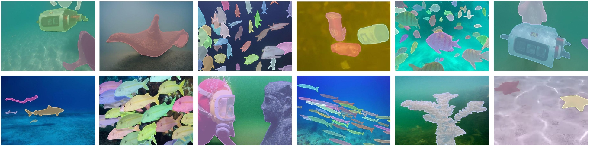

# UIIS10K
[](https://huggingface.co/papers/2505.15581)
[](https://huggingface.co/datasets/LiamLian0727/UIIS10K)
[](https://arxiv.org/abs/2505.15581)
[](LICENSE)

This repository is the official implementation of "[Advancing Marine Research: UWSAM Framework and UIIS10K Dataset for Precise Underwater Instance Segmentation](https://arxiv.org/abs/2505.15581)".

If you found this project useful, please give us a star ⭐️ or [cite](#citation) us in your paper, this is the greatest support and encouragement for us.

## :speech_balloon: Updates
🚩 **News** [2026.11] This paper has been accepted by npj Artificial Intelligence.

[2025.05] We propose a large-scale underwater instance segmentation dataset, [**UIIS10K**](#datasets), which includes **10,048 images** with pixel-level annotations for 10 categories. As far as we know, this is **the largest underwater instance segmentation dataset** available and can be used as a benchmark for evaluating underwater segmentation methods.

  

## Datasets
The dataset follows the COCO format and is organized as follows:
```
    data
      ├── UIIS10K
      |   ├── annotations
      │   │   ├── multiclass_train.json
      │   │   ├── multiclass_test.json
      │   ├── img
      │   │   ├── train_00001.jpg
      │   │   ├── ...
      │   │   ├── test_00001.jpg
      │   │   ├── ...
```
you can get our UIIS10K dataset in [Hugging Face](https://huggingface.co/datasets/LiamLian0727/UIIS10K/tree/main), [Baidu Disk](https://pan.baidu.com/s/1WwDu_jYV8JsPvOGA2l6raQ?pwd=UIIS) (pwd:UIIS), or [Google Drive](https://drive.google.com/file/d/1MYQwWrQW_n9N-q_VPMuQaroIp5gS2f-u/view?usp=sharing).

## Code

The main implementation provides UWSAM-Teacher, UWSAM-Student, Mask GAT-based
Underwater Knowledge Distillation (MG-UKD), and the End-to-end Underwater Prompt
Generator (EUPG).

### Installation

Use Python 3.10 and install a matching PyTorch, torchvision, and full MMCV build.
For a CUDA 12.1 environment supported by PyTorch 2.1:

```bash
conda create -n uwsam python=3.10 -y
conda activate uwsam
pip install torch==2.1.2 torchvision==0.16.2 --index-url https://download.pytorch.org/whl/cu121
pip install "numpy<2" "setuptools<81"
pip install mmcv==2.1.0 -f https://download.openmmlab.com/mmcv/dist/cu121/torch2.1/index.html
pip install -e .
```

MMCV must include its native operators; `mmcv-lite` is insufficient. For another
GPU architecture or CUDA/PyTorch version, use a compatible MMCV build following
[MMCV installation instructions](https://mmcv.readthedocs.io/en/latest/get_started/installation.html).

Run the commands below from this repository's root. Place UIIS10K under
`data/UIIS10K/` using the dataset structure above.

### Prepare pretrained models

```bash
python pretrain/download_pretrained.py sam
python pretrain/download_pretrained.py efficient-sam-vits
```

See the downloader's model choices for SAM ViT-H, EfficientSAM ViT-S, and the
optional SAM2 image encoder. Model weights and datasets retain their respective
upstream terms.

### Train UWSAM

1. Train the teacher:

   ```bash
   bash tools/dist_train.sh configs/uwsam_teacher.py 2
   ```

2. Convert the teacher checkpoint for student initialization:

   ```bash
   python tools/convert_teacher_checkpoint.py \
     work_dirs/uwsam_teacher/best_coco_segm_mAP_epoch_24.pth \
     pretrain/uwsam_teacher.pth
   ```

   Use the actual best checkpoint filename from your training run. Conversion
   maps `backbone.*` to `teacher.*` and retains the other model parameters.

3. Train the student:

   ```bash
   bash tools/dist_train.sh configs/uwsam_student.py 2
   ```

   MG-UKD uses the converted teacher checkpoint. Its reconstruction terms are
   returned with `loss_` prefixes so that MMDetection includes them in the
   optimization objective.

### Evaluate the student

```bash
python tools/test.py configs/uwsam_student_inference.py PATH_TO_STUDENT_CHECKPOINT
```

The inference config omits the teacher and graph distiller. SAM's local
`config.json` is still needed to construct its positional embedding and decoder.
An optional export tool removes training-only teacher/distiller parameters and
training metadata:

```bash
python tools/export_checkpoint.py PATH_TO_STUDENT_CHECKPOINT pretrain/uwsam_student.pth
```

For teacher evaluation, use `configs/uwsam_teacher.py` with the teacher checkpoint.
Training logs and model weights are generated locally; trained release weights
are not included in this repository.

### Code terminology

| Paper component | Implementation |
| --- | --- |
| UWSAM | `uwsam.detector.UWSAM` |
| EUPG | `EUPGNeck`, `EUPGRoIHead`, `EUPGMaskHead` |
| MG-UKD | `MGUKDDistiller`, `MaskGATConnector`, `FeatureReconstructionLoss` |
| Graph construction and attention | `uwsam.graph` |
| Image encoders | `uwsam.backbones` |

Model parameter attribute names are retained where possible for existing
checkpoint compatibility. Config registry names use the terminology above.

### Additional backbone interfaces

We also provide optional Mask R-CNN interfaces so you can try the image encoders
of EfficientSAM, SAM, and SAM2 as backbones:

- `configs/extensions/mask_rcnn_efficient_sam_vits.py`
- `configs/extensions/mask_rcnn_sam_vith.py`
- `configs/extensions/mask_rcnn_sam2_hiera_l.py`

Use these configs with the same training and testing entrypoints.

### Development

```bash
pip install pytest ruff
ruff check .
ruff format --check .
pytest
```

### Acknowledgements

This implementation builds on RSPrompter, MMDetection, EfficientSAM, SAM, SAM2,
and ViTDet. See [NOTICE](NOTICE) and [LICENSES](LICENSES) for source attribution.


### Citation
If you find our repo useful for your research, please cite us:
```
@InProceedings{UIIS_Dataset_2023,
    author    = {Shijie Lian, Hua Li, Runmin Cong, Suqi Li, Wei Zhang, Sam Kwong},
    title     = {WaterMask: Instance Segmentation for Underwater Imagery},
    booktitle = {Proceedings of the IEEE/CVF International Conference on Computer Vision (ICCV)},
    month     = {October},
    year      = {2023},
    pages     = {1305-1315}
}

@article{UIIS10K_Dataset_2025,
    author    = {Hua Li, Shijie Lian, Zhiyuan Li, Runmin Cong, Chongyi Li, Laurence T. Yang, Weidong Zhang, Sam Kwong},
    title     = {Advancing Marine Research: UWSAM Framework and UIIS10K Dataset for Precise Underwater Instance Segmentation},
    year      = {2025},
    journal   = {arXiv preprint arXiv:2505.15581},
}
```

## ⭐ Stargazers
[](https://github.com/LiamLian0727/UIIS10K/stargazers)
